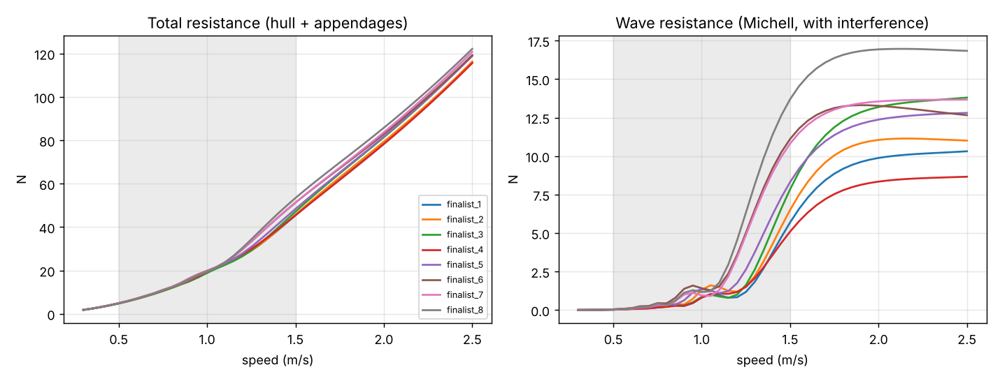

# Stage 2 summary

- designs: 200 (200 evaluated) in 39 s
- Pareto front on (weighted R_T 0.5-1.5 m/s, mass, sway drag): 75
- finalists for stage 3: 8

## Finalists

| name | loa | beam | depth | spacing_inner | mass_total | slenderness | R_T_weighted | R_hull_weighted | R_wave_weighted | R_app_weighted | R_T_top | thrust_margin_top | sway_drag_s2 | v_sway_max_s2 | yaw_rate_max_dps | gm_t | skid_max_height |
|---|---|---|---|---|---|---|---|---|---|---|---|---|---|---|---|---|---|
| finalist_1 | 1.32 | 0.171 | 0.187 | 0.371 | 26.2 | 5.62 | 21.3 | 4.29 | 1.4 | 17 | 78.9 | 2.23 | 25.7 | 0.673 | 188 | 0.752 | 0.0839 |
| finalist_2 | 1.28 | 0.131 | 0.224 | 0.427 | 25.9 | 5.44 | 21.4 | 4.59 | 1.74 | 16.8 | 79.4 | 2.22 | 27.6 | 0.65 | 175 | 0.579 | 0.0666 |
| finalist_3 | 1.32 | 0.204 | 0.224 | 0.361 | 27.4 | 5.54 | 21.5 | 4.58 | 1.85 | 16.9 | 81.4 | 2.16 | 23.3 | 0.707 | 215 | 0.946 | 0.0934 |
| finalist_4 | 1.32 | 0.171 | 0.224 | 0.361 | 27.2 | 5.55 | 21.6 | 4.67 | 1.37 | 16.9 | 78.3 | 2.25 | 24.5 | 0.69 | 200 | 0.797 | 0.0914 |
| finalist_5 | 1.12 | 0.196 | 0.224 | 0.475 | 26.5 | 4.74 | 22.4 | 5.6 | 2.29 | 16.8 | 81.8 | 2.15 | 21.5 | 0.736 | 255 | 1.28 | 0.0803 |
| finalist_6 | 1.01 | 0.155 | 0.221 | 0.304 | 25.1 | 4.36 | 23.4 | 6.73 | 3.28 | 16.7 | 82.9 | 2.12 | 22.7 | 0.717 | 245 | 0.34 | 0.0702 |
| finalist_7 | 1.01 | 0.196 | 0.187 | 0.309 | 25.3 | 4.34 | 23.4 | 6.61 | 3.06 | 16.8 | 83.7 | 2.1 | 20.4 | 0.757 | 301 | 0.6 | 0.0869 |
| finalist_8 | 1.01 | 0.196 | 0.187 | 0.371 | 25.3 | 4.35 | 23.8 | 7.07 | 3.9 | 16.7 | 85.8 | 2.05 | 20.6 | 0.753 | 292 | 0.748 | 0.0831 |

